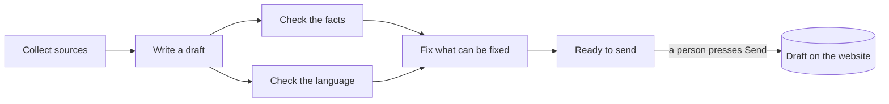

<picture>
  <source media="(prefers-color-scheme: dark)" srcset="./banner-dark.svg">
  <source media="(prefers-color-scheme: light)" srcset="./banner-light.svg">
  
</picture>

## Newsroom automation that waits for you

**AIM** reads the news sources a newsroom cares about, writes a draft, checks the facts and the language, fixes what it can, and then **stops**. Nothing reaches a newsroom's website until a person presses the button, and the website only ever receives drafts.

Editors are never a bottleneck. They are told what AIM found and what it changed, and they can undo any change.

## What we believe

- **A person decides.** AIM prepares. Sending is always a human choice, unless a newsroom's administrator turns automatic sending on, and that switch is recorded.
- **Speed matters in a newsroom.** The pipeline never waits for a person. Checks run together, and every fix can be undone.
- **No training needed.** Large text, large buttons, a word on every button, and plain language throughout.
- **Every newsroom is its own.** Each newsroom has its own sources, settings and data, kept apart from the others.
- **Hong Kong first.** The whole interface is available in English, Traditional Chinese (Hong Kong) and Simplified Chinese, and drafts follow Hong Kong written Chinese news style.

## Where we are

AIM is being rebuilt from the ground up in TypeScript, as a cleaner and faster successor to the original. Collecting news, grouping it into stories, and the writing, checking and fixing pipeline are built and tested end to end. The editor, pictures and sending to a website are next.

In our own tests on real published stories, a story went from start to ready in about 12 seconds at the default setting, for a fraction of a cent. Owners and administrators can choose slower, more careful settings when they want extra checking.

The product is in development and the main repository is private. This profile will grow as there is more to show.

---

AIM Newsroom
